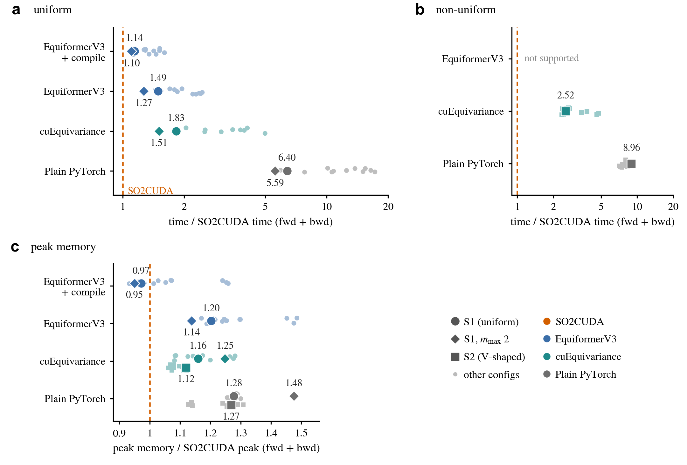
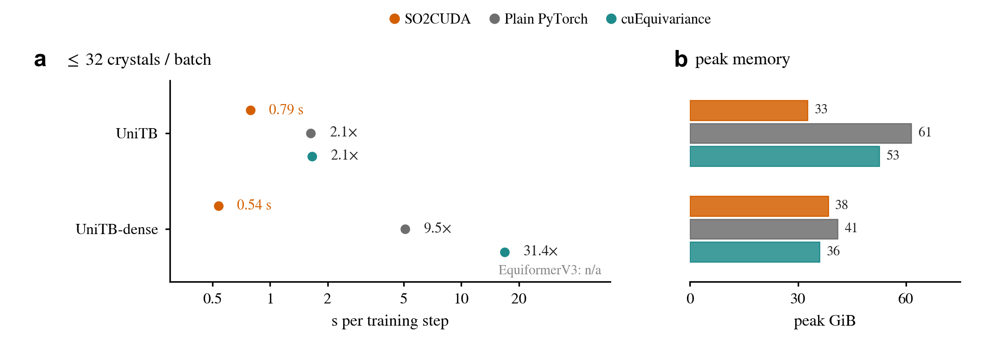

# SO2CUDA

SO2CUDA is a CUDA implementation of the SO(2) tensor products used in eSCN-style equivariant networks. The rotation into each edge frame happens in the kernel that packs features into one block per order $m$ (rotate-as-pack), the linear maps run as GEMMs on these blocks, and the rotation back happens in the kernel that gathers the result (rotate-as-gather). It supports uniform and non-uniform irreps, including different input and output irreps, and top-k mixtures of experts, computes in strict FP32 by default, and serves as an optional backend of DeePTB; the Python package is `so2_cuda_ops`.

## How the four implementations differ

An SO(2) tensor product rotates each edge feature into a frame aligned with the edge, applies one linear map per order $m$, and rotates the result back. SO2CUDA, EquiformerV3, cuEquivariance and our plain PyTorch implementation (after DeePTB's upstream `SO2_Linear`) compute the same function with the same multiply-adds in the linear maps; they differ in data layout, in how they rotate and reorder the data, and in the shapes and number of their GEMMs.


*Drawn for scenario S1 (128 channels for each ℓ ≤ 6). **a**, SO2CUDA rotates each irrep and writes its components straight to their m-block slots (one kernel), runs one GEMM per m, then gathers back (one kernel). **b–d**, The other three rotate with dense or per-ℓ matrices and add slicing, copies, ±m combining or masked writes as separate steps.*

[How it works](docs/how-it-works.md) explains the feature layouts, SO2CUDA's routes for other layers (non-uniform irreps, grouped weights, top-k experts) and the cost of each implementation in stored Wigner entries, kernel launches, time and memory.

<!-- SO2CUDA_BENCHMARKS_BEGIN -->
## Operator performance



*One SO(2) tensor product layer. **a–b**, forward + backward time relative to SO2CUDA for uniform and non-uniform irreps; **c**, peak memory relative to SO2CUDA. Large markers are the scenarios S1, its $m_{\max}=2$ variant and S2; light points are the other measured configurations. Above 1, SO2CUDA is faster or uses less memory.*

| Compared with SO2CUDA | Uniform irreps: time | S1: time | S1: peak memory | Non-uniform irreps: time | S2: time | S2: peak memory |
|---|---:|---:|---:|---:|---:|---:|
| Plain PyTorch | 5.59–17.23× | 6.40× | 1.28× | 7.07–9.22× | 8.96× | 1.27× |
| cuEquivariance | 1.51–4.99× | 1.83× | 1.16× | 2.35–4.78× | 2.52× | 1.12× |
| EquiformerV3 | 1.27–2.45× | 1.49× | 1.20× | N/A | N/A | N/A |
| EquiformerV3 + compile | 1.10–1.60× | 1.14× | 0.97× | N/A | N/A | N/A |

Each entry divides an implementation's forward + backward time (median of 20 measured iterations after 5 warmup iterations) or peak allocated memory by SO2CUDA's, on one NVIDIA H200 in strict FP32 with TF32 disabled; times include input and weight gradients. Geometry is precomputed and each implementation starts from its native feature layout, so the timings exclude Wigner construction and the initial layout conversion, while stored Wigner data count towards peak memory. S1 is `128x0e+128x1o+128x2e+128x3o+128x4e+128x5o+128x6e` and S2 is UniTB's V-shaped hidden irreps `128x0e+24x1o+16x2e+16x3o+32x4e+24x5o+48x6e`, both with 50,000 directed edges; the ranges cover 14 uniform and 12 non-uniform configurations. EquiformerV3 + compile uses slightly less peak memory than SO2CUDA on S1 (0.97×) and on 5 other configurations (0.93–0.98×). Every configuration, timing quartiles and source commits are on the [benchmark page](docs/benchmarks.md).

## Crystal training performance



*One complete training step of UniTB and UniTB-dense on real crystal batches (onsite head). **a**, step time: SO2CUDA in seconds, the other backends relative to it; **b**, peak memory.*

| Model (onsite head) | SO2CUDA step | Plain PyTorch / SO2CUDA | cuEquivariance / SO2CUDA | Peak GiB: SO2CUDA / Plain PyTorch / cuEquivariance |
|---|---:|---:|---:|---:|
| UniTB | 0.79 s | 2.07× | 2.10× | 32.6 / 61.4 / 52.5 |
| UniTB-dense | 0.54 s | 9.49× | 31.40× | 38.3 / 40.9 / 36.0 |

Batches hold real crystal structures from our training set, at most 32 per batch (on average 31.7 structures and 55.9k directed edges), and every backend trains on the same batches in the same order; the table gives the median of 12 measured complete training steps (forward + backward + HybridMuon optimizer) after 4 warmup steps on one NVIDIA H200 in strict FP32 with TF32 disabled. Only the backend of the SO(2) and expert-linear layers changes, and first-step losses and parameter gradients agree within FP32 tolerance. On UniTB-dense, cuEquivariance uses slightly less peak memory than SO2CUDA (36.0 vs 38.3 GiB). EquiformerV3 is not applicable because both models contain non-uniform SO(2) layers. The hopping head, timing quartiles and forward + backward times without the optimizer are on the [benchmark page](docs/benchmarks.md#models-on-real-training-batches).

<!-- SO2CUDA_BENCHMARKS_END -->

## Installation

Requirements: Python 3.9 or later, CUDA-enabled PyTorch, a CUDA Toolkit with `nvcc` and the cuBLAS development libraries, and a host compiler compatible with that toolkit. PyTorch JIT compiles the CUDA extensions on first use (Ninja is installed with the package); set `CUDA_HOME` if PyTorch cannot find the toolkit.

```bash
pip install git+https://github.com/Franklalalala/SO2CUDA.git
```

To develop or run the examples (they also use e3nn), install a checkout and run the tests:

```bash
git clone https://github.com/Franklalalala/SO2CUDA.git
cd SO2CUDA
pip install -e '.[dev]' e3nn
python -c "import so2_cuda_ops; print('CUDA available:', so2_cuda_ops.is_available())"
python -m pytest tests -q
```

The package imports without CUDA; `is_available()` then returns `False` and GPU tests are skipped. The first operator call compiles the extensions and so checks the local toolchain.

## Using SO2CUDA with DeePTB

SO2CUDA works with DeePTB's `1006-stable` branch:

```bash
pip install 'git+https://github.com/Franklalalala/DeePTB.git@1006-stable'
```

With SO2CUDA installed, DeePTB calls `so2_cuda_ops.deeptb` through `dptb.nn.so2_backend` for every layer that meets the CUDA FP32, layout and routing requirements: UniTB-dense through `dense_pairs`, UniTB's PDQ-MoE layers through `activation_forward` and grouped GEMM, and other dense layers through `true_dense_pairs`. CPU tensors, other dtypes and unsupported calls run DeePTB's PyTorch implementation, and errors in native CUDA execution propagate. SO2CUDA does not import DeePTB; DeePTB keeps the model parameters and checkpoints. [usage.md](docs/usage.md) describes the interfaces, including a direct grouped-GEMM call.

## Minimal use for interatomic potentials

[minimal_so2_tp.py](examples/minimal_so2_tp.py) applies a complete SO(2) tensor product to e3nn features without DeePTB. Input and output irreps may differ and may be uniform (`32x0e+32x1o+32x2e`) or non-uniform (`128x0e+64x1o+32x2e`). Features use e3nn's `mul_ir` layout `[edges, irreps.dim]`, and edge vectors give a constant rotation, so prepare the layout and Wigner data once per edge geometry. From the repository root:

```python
import torch
from e3nn import o3
from examples.minimal_so2_tp import prepare_so2_tp, make_weights
from so2_cuda_ops.deeptb import true_dense_pairs

irreps = o3.Irreps("128x0e+64x1o+32x2e")
edge_vectors = torch.randn(512, 3, device="cuda", dtype=torch.float32)
x = torch.randn(512, irreps.dim, device="cuda", dtype=torch.float32, requires_grad=True)
layout, wigner = prepare_so2_tp(irreps, irreps, edge_vectors, m_max=2)
weights = make_weights(irreps, irreps, 2, device=x.device)
parts = None if wigner is None else true_dense_pairs(x, layout, wigner, weights, include_m0=True)
if parts is None:
    raise RuntimeError("Use your PyTorch reference implementation for this input")
y = parts[0]
y.square().mean().backward()
```

`make_weights` creates trainable $m=0$ weights and stacked `[A_m; B_m]` weights shared across edges; a model can pass its own `LinearWeights`. The interface takes FP32 tensors on one CUDA device. For CPU tensors, other dtypes, autocast, `torch.func`, geometry that requires gradients or unsupported layouts it returns `None`, so the caller can use its own PyTorch path.

## Reproducing the benchmarks

The [benchmark page](docs/benchmarks.md#reproducing-the-measurements) gives the exact commands, including the cuEquivariance version and the EquiformerV3 commit. With SO2CUDA installed from a checkout, the operator comparison against the plain PyTorch implementation runs from the repository root:

```bash
python examples/so2_operator_speed_test.py --impl naive,so2cuda --suite all --json operator.json
```

The training data are not public. With DeePTB installed as above, synthetic periodic structures give a runnable relative-timing comparison of UniTB and UniTB-dense; it measures timing only and does not reproduce the real-batch results:

```bash
python examples/deeptb_speed_test.py --model both --backend both --edges 20000 --json synthetic_so2cuda.json
```

[update_readme_benchmarks.py](examples/update_readme_benchmarks.py) generates the performance sections of this README, the benchmark page and the public JSON in `docs/benchmarks/` from measurement records; [operator-benchmark.md](docs/operator-benchmark.md) describes the measurement contract.

## Build and runtime settings

- `CUDA_HOME`, `CC`, `CXX`: CUDA Toolkit and compatible compilers; `MAX_JOBS` limits parallel compilation.
- `TORCH_EXTENSIONS_DIR`, `SO2_CUDA_PACK_SCATTER_BUILD_DIR`, `SO2_CUDA_CUBLAS_GROUPED_BUILD_DIR`: JIT cache and build directories; set all three to keep every build product in one place.
- `SO2_CUDA_BACKEND`: DeePTB backend policy, `auto` by default; `off` forces the PyTorch path.
- `SO2_CUDA_FAST_TF32`: `1` lets the cuBLAS GEMMs use TF32; the default `0` keeps strict FP32, as in the benchmarks.
