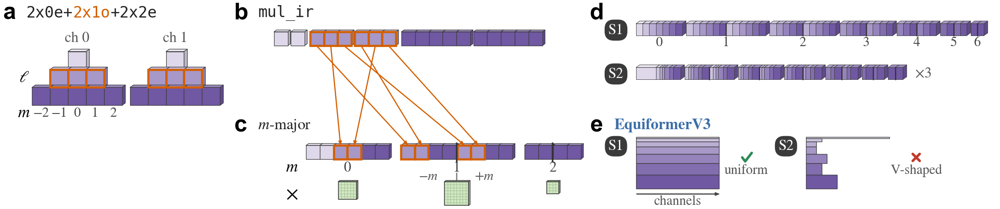
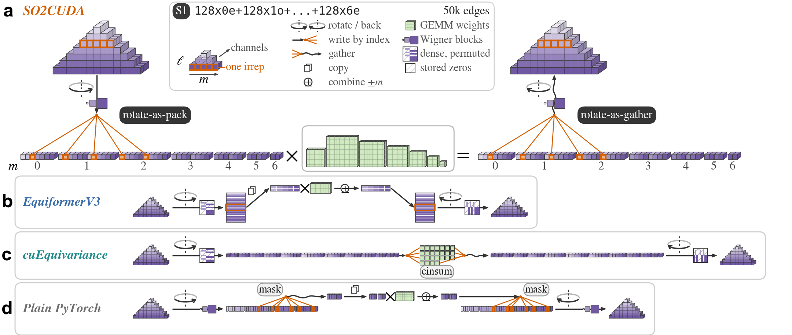
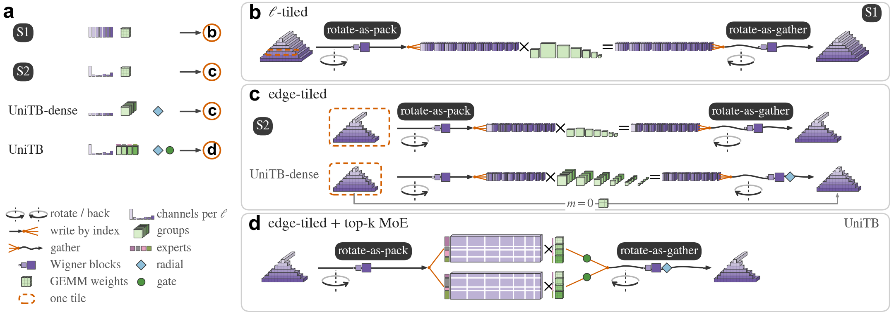
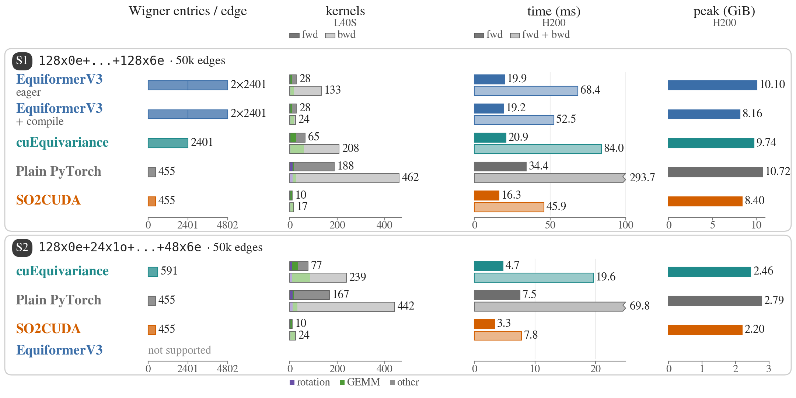

# How it works

An SO(2) tensor product rotates each edge feature into a frame whose pole is the edge direction, applies one linear map per order m, and rotates the result back. SO2CUDA, EquiformerV3, cuEquivariance and our plain PyTorch implementation compute the same function; they differ in how they lay out the data, rotate and reorder it, and split the linear maps into GEMMs. The figures use two scenarios, both with 50,000 directed edges: S1 is `128x0e+128x1o+128x2e+128x3o+128x4e+128x5o+128x6e` (uniform irreps), and S2 is UniTB's V-shaped hidden irreps `128x0e+24x1o+16x2e+16x3o+32x4e+24x5o+48x6e`. Measured times and memory for every configuration are on the [benchmark page](benchmarks.md).

## Feature layouts

**a**, What irreps mean, for an illustrative `2x0e+2x1o+2x2e`: every ℓ has two channels (ch 0, ch 1), and each channel is a (2ℓ+1)-vector with components m = −ℓ…ℓ; colour encodes ℓ. The orange outlines are the two ℓ = 1 vectors, i.e. the `2x1o` printed in the same colour in the title. **b**, e3nn's `mul_ir` stores irrep by irrep, channel outer and m inner, so each vector is contiguous. **c**, SO2CUDA's m-major blocks: one block for m = 0 and one for every m > 0, with −m left and +m right of the divider; within a half, ℓ is outer and the channel inner (as in `_side` of [`_sandwich.py`](../src/so2_cuda_ops/_sandwich.py) and the rotation kernels). The orange arrows give the destination of each of the six components of `2x1o`: components with the same m end up in the same block. The green block under each block is its weight: one multiplication, i.e. one GEMM, per block. **d**, The blocks of S1 (128 channels per ℓ, ℓmax 6) and S2 (UniTB's V-shaped hidden irreps); width = number of columns, S2 drawn three times larger. **e**, EquiformerV3 stores an edge as [49 coefficients × C channels], one band per ℓ, which requires the same C for every ℓ: S1 forms a rectangle, S2 does not.

## Four implementations of one SO(2) tensor product

Scenario S1 (50k edges); legend at the top centre. Nodes are data: a voxel staircase is the features of one edge (row = ℓ, across = m, depth = channels), bars and sheets are buffers, green blocks are GEMM weights. Arrows are actions. The glyph beside an arrow is a rotation D (reversed: the rotation back, Dᵀ); the icon on the shaft is the Wigner matrix it uses, either per-ℓ blocks (only the (2ℓ+1)² non-zero blocks) or a dense matrix (hatching = stored zeros; staggered purple rows = rows permuted; icons drawn for ℓ ≤ 2). Lines fanning out write by index; lines fanning in followed by a wavy arrow gather; two sheets copy; a circled ± combines the +m and −m parts.

- **a**, SO2CUDA. rotate-as-pack is one kernel: it reads one irrep of one channel (orange, the 5 components of ℓ = 2), multiplies it by the Wigner block of that ℓ and writes every component by index straight into its cell of the m-major blocks (m = 0, ±1, ±2). One GEMM per m follows, with ±m folded into one block weight. rotate-as-gather is a second kernel: it reads the same 5 cells back by index, multiplies by Dᵀ and writes the same row of the output. Rotation and write sit on one arrow: they are one step.
- **b**, EquiformerV3 folds the m-major permutation into a dense 49×49 matrix per edge, so one bmm rotates and reorders at once, at the price of also multiplying its zeros (81%). The result is a [49 coefficients × C] sheet whose rows run m = 0, then +m before −m for every m. Then, for every m, the ±m rows are sliced and copied to contiguous memory (one copy per m), multiplied by a rectangular weight (each row to twice its width), combined (one subtraction, one addition) and put back. A second stored dense matrix rotates back. Drawn for m = 2.
- **c**, cuEquivariance (`escn_tp_compact`, `naive` method, PyTorch rotation) also folds a permutation into a dense matrix, in descriptor order (m = −6…6). Then one `einsum` per path (25 paths) slices segments and sums them back. The rotation back reads the transpose of the same matrix.
- **d**, Plain PyTorch (our baseline after DeePTB's upstream `SO2_Linear`) rotates with per-ℓ blocks and stores the result as `mul_ir`. Then, for every m, boolean masks gather the ±m components, a copy makes them a contiguous [−m | +m] matrix, which is multiplied, combined and written back through the masks. Finally each irrep is rotated back. The per-m steps sit on the raised segment, drawn for m = 4.

All four implementations do the same linear multiply-adds (6.77 M per edge in S1). They differ in GEMM shapes and call counts, in whether the data are contiguous, and in the cost of rotation and reordering; the [cost figure](#costs-in-s1-and-s2) gives the numbers.

## SO2CUDA's execution routes

Routes for the four configurations shown. Symbols as in the figure above; legend below **a**; staircase depth = channels of each ℓ (one voxel = 16 channels).

- **a**, The four configurations and their routes: S1; S2; a UniTB-dense hidden layer (32 channels per ℓ, one weight set per crystal structure, radial weights); a UniTB hidden layer (V-shaped irreps, 4 experts with top-2, radial weights and gates).
- **b**, ℓ-tiled kernels (S1): one tile (dashed orange) is 32 channels of one ℓ of one edge, handled by one warp. This route needs all of: the same channel count per ℓ on input and output, C a multiple of 32, ℓmax ≤ 8, every m ≥ 1 block complete, C > 32 or ℓmax > 2, and a call with a single weight set and no gates or radial weights ([`_sandwich.py`](../src/so2_cuda_ops/_sandwich.py)).
- **c**, Edge-tiled kernels: one tile is a whole edge, handled by one thread block in shared memory. Top: S2, one weight set, no radial weights. Bottom: a UniTB-dense hidden layer, one weight set per structure run as one grouped GEMM. Its input (node and edge features concatenated) is wider than its output, so by DeePTB's rule its radial weights come after the linear map and are applied in rotate-as-gather (◆). DeePTB computes its m = 0 term separately and adds it (grey line), so the fused path holds the m > 0 blocks only. Blocks drawn for S2, 2.6 times the scale of **b**.
- **d**, Edge-tiled kernels with top-k MoE routing (UniTB): one rotate-as-pack writes K = 2 copies, the rows of each sorted by the expert of its slot (colour tabs); each copy runs one grouped GEMM in which every row segment uses its expert's weights; one rotate-as-gather sums the copies weighted by the gates (●), applies the radial weights and rotates back.

The figure shows only the routes these four configurations take. The edge-tiled kernels also need compact or identity Wigner data and an edge that fits in shared memory; otherwise rotation and gather fall back to a general per-(edge, channel) kernel ([`so2_channel_kernels.cu`](../src/so2_cuda_ops/csrc/so2_channel_kernels.cu)).

## Costs in S1 and S2

- **Wigner entries / edge**: matrix entries stored per edge. EquiformerV3 keeps one dense 49×49 matrix for rotating in and another for rotating back (2×2,401); cuEquivariance keeps one and reads its transpose to rotate back (591 in S2, split into 5 multiplicity groups); plain PyTorch and SO2CUDA keep per-ℓ blocks (455, of which the ℓ = 0 entry is passed through).
- **Kernels**: CUDA kernels launched by one call; upper bar forward, lower bar backward, stacked as rotation (purple), GEMMs of the linear map (green) and everything else (grey: copies, zero fills, gradient accumulation, mask indexing, elementwise ops, Triton fused kernels), total at the end. Forward is counted under `no_grad`; backward = (forward + backward) − (forward with autograd), both from the same execution mode. Counted, not timed, with `torch.profiler` on an L40S; on another GPU cuBLAS may pick different algorithms (split-K adds a reduction kernel); memcpy and memset are not counted.
- **Time**: measured H200 medians in strict FP32; dark: forward (`no_grad`), light: forward + backward. The two bars beyond the axis end in a jagged cap, with their true values.
- **Peak**: allocated memory over forward + backward; in S1, EquiformerV3 with `torch.compile` (8.16 GiB) stays slightly below SO2CUDA (8.40 GiB).

Operator timings start from precomputed geometry and each implementation's native layout, so they exclude Wigner construction and the initial layout conversion; the stored Wigner data count towards peak memory.
